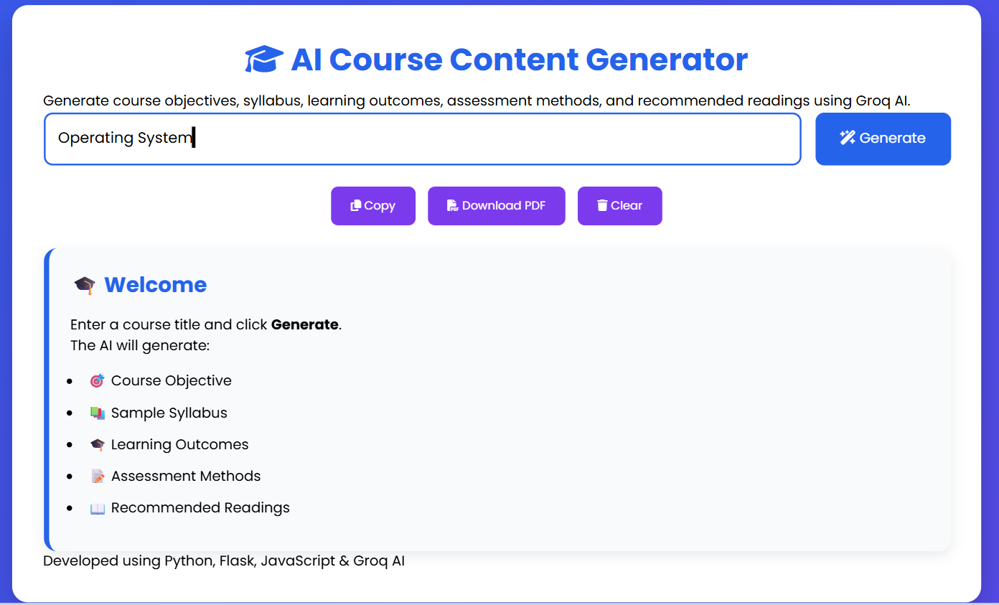

# 🎓 AI Course Content Generator

An AI-powered web application that dynamically generates structured educational course content from a given course title using the **Groq API**.

Built using Python (Flask) for the backend and HTML, CSS, and JavaScript for the frontend.


## 📖 Project Overview

The AI Course Content Generator is a web-based AI application that automatically creates structured educational course content from a course title entered by the user.

Using the Groq API, the application generates:

- 🎯 Course Objective
- 📚 Sample Syllabus
- 🎓 Three Learning Outcomes aligned with Bloom's Taxonomy
- 📝 Assessment Methods
- 📖 Recommended Readings

The generated content is displayed in a clean, user-friendly interface and can be copied or downloaded as a PDF.

## ✨ Features

- 🤖 AI-powered educational content generation
- 📘 Complete course structure generation
- 🎯 Bloom's Taxonomy-based learning outcomes
- 📚 Dynamic syllabus generation
- 📝 Assessment methods with weightage
- 📖 Recommended books and references
- 📋 Copy generated content
- 📄 Download content as PDF
- 📱 Responsive user interface
- ⚠️ Error handling
- 🔒 Secure API key management using environment variables

## 🛠️ Technologies Used

### Backend
- Python
- Flask
- Groq API
- python-dotenv

### Frontend
- HTML5
- CSS3
- JavaScript

### Libraries
- html2pdf.js
- Font Awesome

## 📂 Project Structure

```text
AI-Course-Content-Generator/
│
├── main.py
├── requirements.txt
├── README.md
├── .env.example
├── .gitignore
│
├── templates/
│   └── index.html
│
├── static/
│   ├── style.css
│   └── script.js
│
└── screenshots/
    ├── home.png
    ├── input.png
    ├── loading.png
    ├── generated.png
    └── pdf.png
```

## 🚀 Installation and Setup

### 1. Clone the repository

```bash
git clone https://github.com/PalakD42/AI-Course-Content-Generator.git
```

### 2. Navigate to the project folder

```bash
cd AI-Course-Content-Generator
```

### 3. Create a virtual environment

```bash
python -m venv venv
```

### 4. Activate the virtual environment

**Windows:**

```bash
venv\Scripts\activate
```

### 5. Install dependencies

```bash
pip install -r requirements.txt
```

### 6. Configure the API key

Create a `.env` file in the root directory:

```env
GROQ_API_KEY=YOUR_GROQ_API_KEY
```

Replace the placeholder with your actual Groq API key.

**Important:** Never upload your actual `.env` file or API key to GitHub.

### 7. Run the application

```bash
python main.py
```

### 8. Open in your browser

```text
http://127.0.0.1:5000
```

## 💻 How It Works

1. The user enters a course title.
2. The frontend sends the request to the Flask backend.
3. Flask forwards the prompt to the Groq API.
4. The AI generates structured educational content.
5. The generated content is displayed on the webpage.
6. Users can copy or download the generated content as a PDF.

## 📷 Screenshots

### 🏠 Home Page


### ✍️ Enter Course Title



### ⏳ Generating Content


### 📄 Generated Course Content


### 📥 Download PDF


## 📚 Example

**Input:**

```text
Operating System
```

**Generated Output:**
- Course Objective
- Five-module Syllabus
- Learning Outcomes
- Assessment Methods
- Recommended Readings

## 🔒 Data Privacy

- API keys are stored securely using environment variables.
- No user data is permanently stored by the application.
- User input is used for AI-based course generation.

## 🌱 Future Enhancements

- 🌙 Dark Mode
- 👤 User Authentication
- 🗂️ Course History
- 📄 Export to Microsoft Word
- 📊 Export to Excel
- 🌍 Multi-language Support
- 🗄️ Database Integration
- 🤖 Support for Multiple AI Models

## 📋 Requirements

- Python 3.10 or above
- Flask and required Python dependencies
- Groq API key
- Internet connection

## 👨‍💻 Author

**Palak Dwivedi**

Engineering Student | AI & ML Enthusiast

- **GitHub:** [PalakD42](https://github.com/PalakD42)
- **LinkedIn:** [Connect with me](https://www.linkedin.com/in/palak-dwivedi-019445360/)
- **Portfolio:** [Visit My Portfolio](https://palakd42.github.io/MyPortfolio/)

## 📜 License

This project is developed for educational purposes and is licensed under the **MIT License**.

See the [LICENSE](LICENSE) file for details, if included in the repository.

---

⭐ If you find this project interesting, consider giving it a star!
